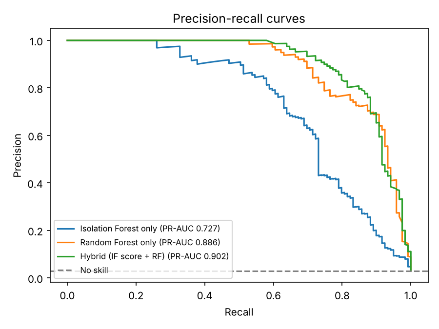
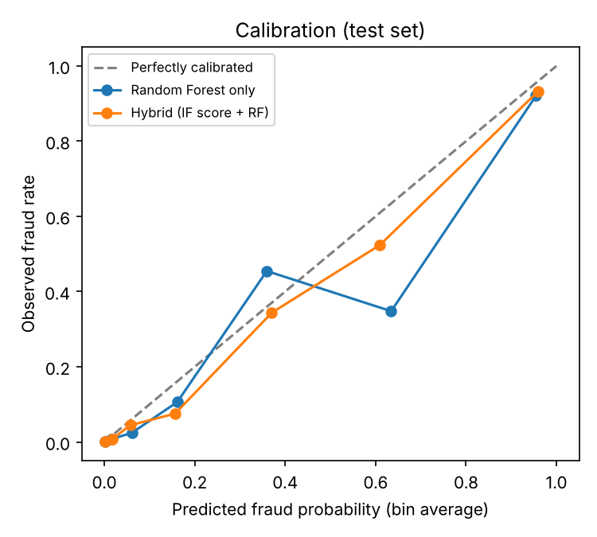
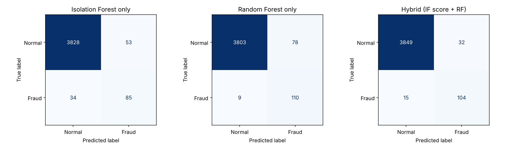

# Simple Credit Card Fraud Detection

[](https://github.com/dguo97/simple-credit-card-fraud-detection/actions/workflows/ci.yml)
[](https://colab.research.google.com/github/dguo97/simple-credit-card-fraud-detection/blob/main/notebooks/fraud_detection_colab.ipynb)

A hybrid fraud detector built with scikit-learn. An Isolation Forest scores how
unusual each transaction looks, and that score is fed into a Random Forest
classifier whose probabilities are calibrated. It runs on synthetic data
generated on the fly, so there is nothing to download and it is easy to type in
a transaction and test it.

## Running in Google Colab

The quickest way: click the **Open in Colab** badge above for a ready-made notebook.
Or do it by hand:

1. Open [colab.research.google.com](https://colab.research.google.com) and create a **New notebook**.
2. Clone the repository and install the dependencies:

```python
!git clone https://github.com/dguo97/simple-credit-card-fraud-detection.git
%cd simple-credit-card-fraud-detection
!pip install -q -r requirements.txt
```

3. Check a transaction. Use a Python cell so the prompts can accept your input:

```python
import fraud_detection as fd

model = fd.load_or_train()           # trains on synthetic data the first time
fd.prompt_user_transaction(model)    # asks for amount, category, type, ...
```

   Or pass a transaction directly from a shell cell:

```python
!python fraud_detection.py --amount 450 --category Electronics --type Online --weekend --hour 3 --distance-km 400
```

4. Evaluate the model and view the plots:

```python
!python fraud_detection.py evaluate --plots

from IPython.display import Image, display
display(Image("confusion_matrix.png"), Image("pr_curve.png"), Image("calibration.png"))
```

To run locally instead, clone the repo, run `pip install -r requirements.txt`,
then `python fraud_detection.py` for the interactive prompts.

## Dataset overview

The dataset is synthetic and generated every time the code runs, so there is no
file to download.

- **Size:** 20,000 transactions by default (`--n-samples` changes this), about 3% fraud
- **Target:** `Fraud_Label` (0 = normal, 1 = fraud)
- **Features:**

| Feature | Description |
|---------|-------------|
| `Transaction_Amount` | Amount in dollars |
| `Merchant_Category` | Grocery, Electronics, Travel, Dining or Retail |
| `Transaction_Type` | In-Store, Online or ATM |
| `Is_Weekend` | 0 or 1 |
| `Hour` | Hour of day, 0 to 23 |
| `Txns_Last_Hour` | Transactions on the card in the last hour, including this one |
| `Distance_From_Home_Km` | Distance from the cardholder's home |

- **Split:** stratified 80% train / 20% test (16,000 / 4,000), so both sets keep the same fraud rate
- **Realism:** fraud cases are drawn from their own distribution rather than from a rule: larger amounts (or small "card-testing" charges), more electronics and travel, mostly online, often at night, sometimes in a burst of several transactions in an hour, and often far from home. Many fraud cases still look completely ordinary, so the classes overlap and no model can score perfectly.

## How it works

1. **Preprocessing:** `RobustScaler` on the amount and distance (both heavily skewed) and one-hot encoding for category and type.
2. **Isolation Forest:** an unsupervised model that isolates unusual transactions. Its anomaly score is computed out-of-fold (5-fold), so the classifier trains on scores that look like the ones it will see on new data.
3. **Random Forest:** trained on the original features plus the anomaly score, with `class_weight="balanced_subsample"` to cope with the rare fraud class. `min_samples_leaf` is chosen by cross-validated PR-AUC on the training data only.
4. **Calibration:** class weighting inflates the raw probabilities, so the forest is wrapped in isotonic calibration. A predicted 20% then means roughly 20% of such transactions are fraud. Reported probabilities are kept within 0.1% to 99.9%, because a model should not claim certainty.
5. **Decision threshold:** instead of an arbitrary 0.5, the cut-off is chosen to minimise expected cost on held-out training data, assuming a missed fraud costs 10 times a false alarm (`--fn-cost` and `--fp-cost` change this). With well-calibrated probabilities the best cut-off is near 1/11 (about 9%); the checker's model uses 12%.

### Trying transactions

`python fraud_detection.py` asks for the first four details, then three optional
ones (press Enter to use the default: hour 12, one transaction in the last hour,
5 km from home). You can also pass everything as flags:

```bash
python fraud_detection.py --amount 450 --category Electronics --type Online --weekend --hour 3 --txns-last-hour 4 --distance-km 400
```

| Transaction | Fraud probability | Verdict |
|-------------|-------------------|---------|
| $45.50, Dining, In-Store, 7pm, 3 km from home | 0.1% | Normal |
| $150.00, Retail, Online, 3pm, 8 km from home | 0.1% | Normal |
| $450.00, Electronics, Online, weekend (default hour and distance) | 78.7% | Fraud |
| $60.00, Dining, ATM, 1am, 700 km from home | 87.8% | Fraud |
| $8.00, Retail, Online, 2am, 5 transactions in the hour | 73.5% | Fraud (looks like card testing) |
| $450.00, Electronics, Online, weekend, 3am, 4 transactions in the hour, 400 km from home | 99.9% | Fraud |

Flags for `check`: `--amount`, `--category`, `--type` (give these three together),
`--weekend`, `--hour`, `--txns-last-hour`, `--distance-km`, `--threshold` (default:
the model's cost-optimised cut-off), `--retrain` and `--model-path`. Input is
case-insensitive and invalid input is rejected with a clear message. The first run
trains the model (a few seconds) and saves it to `fraud_model.joblib`. Only load
model files you created yourself, since joblib files are pickles.

## Evaluating the model

```bash
python fraud_detection.py evaluate --plots          # one run, saves the plots
python fraud_detection.py evaluate --seeds 5        # mean ± std over 5 fresh datasets
```

Each run generates a fresh dataset, makes a stratified 80/20 split, and does all
tuning (`min_samples_leaf`, decision threshold) on the training part only. The test
part is used once, for reporting. `--no-tune` skips the cross-validated tuning for
a faster run.

### Results

One run (20,000 transactions, seed 42). Cost/1k is the expected cost per 1,000
transactions, where a missed fraud costs 10 and a false alarm costs 1:

| Model | Threshold | Precision | Recall | F1 | PR-AUC | ROC-AUC | Cost/1k |
|-------|-----------|-----------|--------|----|--------|---------|---------|
| Isolation Forest only | own | 0.616 | 0.714 | 0.661 | 0.727 | 0.962 | 98.2 |
| Random Forest only | 0.14 | 0.585 | 0.924 | 0.717 | 0.886 | 0.990 | 42.0 |
| Hybrid (IF score + RF) | 0.31 | 0.765 | 0.874 | 0.816 | 0.902 | 0.991 | 45.5 |

Five different seeds, fresh data each time (mean ± standard deviation):

| Model | Precision | Recall | F1 | PR-AUC | ROC-AUC | Cost/1k |
|-------|-----------|--------|----|--------|---------|---------|
| Isolation Forest only | 0.649 ± 0.049 | 0.641 ± 0.042 | 0.643 ± 0.033 | 0.691 ± 0.043 | 0.947 ± 0.015 | 115.8 ± 12.8 |
| Random Forest only | 0.621 ± 0.063 | 0.857 ± 0.054 | 0.718 ± 0.050 | 0.856 ± 0.036 | 0.978 ± 0.009 | 57.7 ± 16.7 |
| Hybrid (IF score + RF) | 0.634 ± 0.078 | 0.852 ± 0.039 | 0.726 ± 0.060 | 0.860 ± 0.036 | 0.977 ± 0.009 | 58.4 ± 14.8 |

What this shows:

- **Supervised learning clearly beats the unsupervised score alone.** Isolation Forest by itself reaches PR-AUC 0.69, against about 0.86 for either Random Forest.
- **The anomaly score adds almost nothing here.** The hybrid and the plain Random Forest are within noise of each other: the hybrid wins on PR-AUC in 3 of 5 seeds and on cost in only 2 of 5. This is a fair result to report rather than hide: the extra features (hour, burst, distance) already carry the signal that an anomaly score would add. Whether the hybrid helps more when labelled fraud is scarce is not tested here.
- **Calibration works.** Predicted probabilities track the observed fraud rate (plot below).
- **Single runs are noisy.** With only about 119 fraud cases in a test set, the winner changes from seed to seed, and so do the chosen thresholds. Prefer the multi-seed table.
- **PR-AUC is the headline metric.** With 3% fraud, accuracy is meaningless: predicting "normal" every time already scores 97%.

| Precision-recall curves | Calibration |
|-------------------------|-------------|
|  |  |



### Use it from Python

```python
from fraud_detection import HybridFraudModel, generate_synthetic_data, score_transaction

X, y = generate_synthetic_data(20000)
model = HybridFraudModel().fit(X, y)
score_transaction(model, 450, "Electronics", "Online", True, hour=3, distance_km=400)
```

## Tests

```bash
pip install -r requirements-dev.txt
pytest
```

The suite takes a couple of minutes because it trains real models. GitHub Actions
runs it on Python 3.10 to 3.13 for every push.

## Limitations

- **The data is synthetic, and I wrote the generator.** The model learns the
  patterns I put in (night-time, distant, bursty, online electronics), so the
  scores show that the pipeline works, not how well it would catch real fraud.
  Real data is messier, far more imbalanced (a fraction of a percent is common), anonymised
  and drifts over time, so a real dataset with a time-based split would be the
  natural next step.
- The cost ratio (10 to 1) is an assumption. The right value depends on the
  business, and the chosen threshold moves with it.
- This is a demonstration, not a production fraud system.

## License

MIT, Copyright (c) 2026 David Guo (see `LICENSE`).
